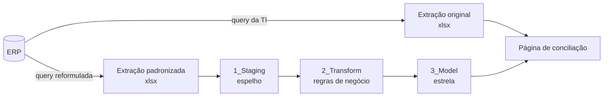

# Basalto | Base comercial confiável

> **Decisão em jogo:** posso confiar nesses números?

Projeto 1 do portfólio de Inteligência Comercial. Empresa, pessoas e números são fictícios.

## 1. Contexto

A Basalto Athletic & Menswear vende moda masculina e athleisure por quatro canais: multimarcas (representantes comerciais e supervisores regionais), marketplaces, e-commerce próprio e lojas próprias.

As queries de extração chegaram prontas da TI, mas sem tratamento: nomes abreviados do ERP, aliases inconsistentes, linhas duplicadas pela integração e pedidos cancelados misturados às vendas. A receita do marketplace não batia com a contabilidade em nenhum mês.

## 2. Decisão em jogo

Antes de qualquer painel de metas, preço ou carteira, a liderança comercial precisa de uma base única e conferida. O projeto responde:

- O que está errado nas extrações, e quanto isso distorce a receita?
- Que padrão de nomes e que regras de negócio passam a valer para todos?
- A base tratada bate com a contabilidade?

## 3. Dados e arquitetura

| Etapa | O que foi feito | Onde |
|---|---|---|
| Recebi | Queries originais da TI | [`sql/01_ti_original/`](sql/01_ti_original/) |
| Diagnostiquei | 9 problemas medidos em linhas e em reais | [`sql/02_diagnostico/`](sql/02_diagnostico/), [`docs/diagnostico.md`](docs/diagnostico.md) |
| Padronizei | Queries reescritas no padrão `Entidade_Atributo` | [`sql/03_staging/`](sql/03_staging/), [`docs/padrao-de-nomes.md`](docs/padrao-de-nomes.md) |
| Tratei | Regras de negócio na camada Transform do Power Query | [`docs/regras-de-negocio.md`](docs/regras-de-negocio.md), [`powerbi/`](powerbi/) |
| Conferi | Conciliação com a contabilidade, no SQL e no Power BI | [`sql/04_qualidade/`](sql/04_qualidade/) |

As extrações em [`dados/`](dados/) simulam o resultado de cada query: `extracao_ti/` é o que a TI entregaria; `extracao_stg/` é a versão padronizada que alimenta o Power BI.

## 4. Métricas-chave

*Em construção: definidas no modelo do Power BI.*

## 5. Achados e recomendação

- **Duplicidade da integração:** 804 itens do marketplace chegavam duas vezes, inflando a receita do canal em R$ 185.722,96. A divergência aparecia em todos os 45 meses.
- **Causa:** as linhas eram idênticas, exceto o número da carga, campo que a query da TI não trazia. Incluí o campo e mantive a primeira carga.
- **Produto fora do padrão:** 689 linhas do e-commerce (R$ 145 mil) não encontravam o cadastro por diferença de maiúsculas e espaços.
- **Cliente duplicado:** 8 clientes tinham dois códigos para o mesmo CNPJ. Ao unificar, a carteira dos códigos duplicados se sobrepunha à original e duplicaria vendas no cruzamento com a carteira.
- **Resultado:** depois do tratamento, a receita bate com a contabilidade em todos os 180 cortes de mês e canal.

**Recomendação:** adotar a extração padronizada como fonte única dos painéis comerciais e manter a conciliação como checagem obrigatória a cada atualização.

## 6. Limitações

- Dados sintéticos; os comportamentos seguem premissas, não estatísticas de mercado.
- Sem impostos, frete, comissão de marketplace ou custo de devolução.
- Canais diretos agregados por canal, sem dados de consumidor final.
- As queries foram executadas em SQLite com sintaxe próxima ao T-SQL; diferenças estão comentadas no código.
